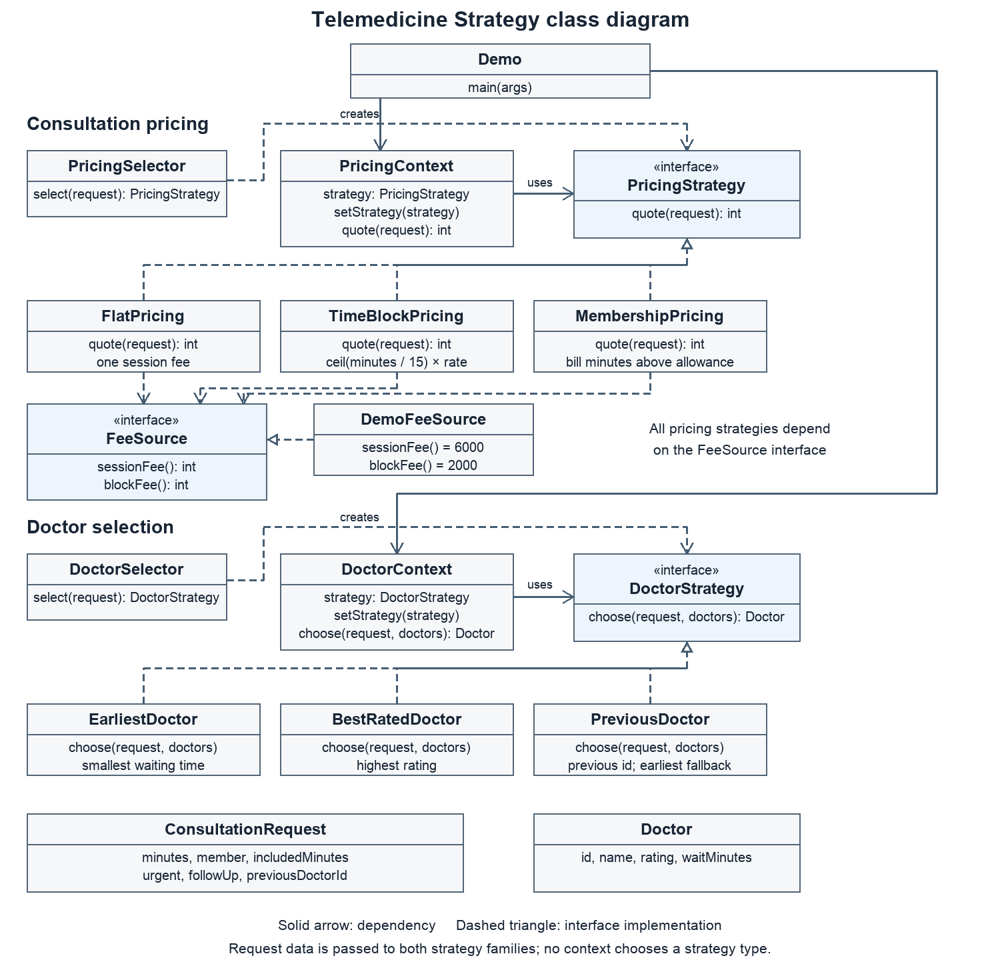

# Assignment 5 Strategy Pattern in Telemedicine

**Student:** Assem Tugelbay  
**Group:** SE-2540  
**Domain:** Topic 19 Telemedicine

This program calculates consultation fees and chooses a doctor through two independent Strategy families.
The code for Assignment 5 is separate from Assignment 4.

## Build and run

Install Java 17 or newer and Maven. Run the full demo with one command:

```sh
sh run.sh
```

The script runs the tests, builds the JAR and starts the demo. To run only tests:

```sh
mvn test
```

## Six different algorithms

| Family | Strategy | Rule |
|---|---|---|
| Pricing | FlatPricing | One fee per consultation |
| Pricing | TimeBlockPricing | Each started 15 minute block is billed |
| Pricing | MembershipPricing | Included minutes are deducted before billing excess blocks |
| Doctor | EarliestDoctor | Pick the smallest waiting time |
| Doctor | BestRatedDoctor | Pick the highest patient rating |
| Doctor | PreviousDoctor | Match the previous doctor id; use the earliest available doctor when absent |

For the **same 50 minute member visit with 30 included minutes**, prices are 6000, 8000 and 4000 KZT.
For the same candidate list, doctor strategies choose Dr Ali, Dr Lee and Dr Kim.
Tariffs and clinician records are illustrative demo data.

## Contexts and runtime replacement

Both contexts accept an interface in the constructor, provide `setStrategy()` and delegate the operation.
They contain no strategy-type `if`, `switch` or `instanceof`.

```java
PricingContext pricing = new PricingContext(new FlatPricing(fees));
pricing.quote(visit); // 6000
pricing.setStrategy(new MembershipPricing(fees));
pricing.quote(visit); // 4000, same context and input
pricing.setStrategy(new PricingSelector(fees).select(visit));
```

The demo repeats this manual, runtime and automatic sequence for doctor selection.

## Automatic selection rules

PricingSelector checks membership first, then duration above 30 minutes, then the flat-price fallback.
DoctorSelector checks urgency first, then follow up, then the best-rated fallback.
An urgent follow-up therefore uses EarliestDoctor.

Only selectors branch to choose a strategy type. Input validation is performed in ConsultationRequest.

## Isolation from external change

FeeSource hides the clinic tariff source. DemoFeeSource provides sample tariff values.
The strategies depend on FeeSource, so a future file, database or API source can replace it.
Tests use FakeFees with fixed results. Another fake verifies that changing the source changes fees without changing an algorithm.

## Class responsibilities

Each class has one responsibility.

| Class or interface | Single responsibility |
|---|---|
| ConsultationRequest | Stores validated consultation input. |
| Doctor | Stores clinician identity, rating, waiting time. |
| PricingStrategy | Defines the consultation fee contract. |
| FlatPricing | Charges one session fee. |
| TimeBlockPricing | Charges each started fifteen minute block. |
| MembershipPricing | Bills time beyond the included allowance. |
| PricingContext | Delegates fee calculation to its current strategy. |
| PricingSelector | Selects pricing from membership status, consultation duration. |
| FeeSource | Defines access to external clinic tariffs. |
| DemoFeeSource | Supplies illustrative clinic tariff values. |
| DoctorStrategy | Defines the clinician selection contract. |
| EarliestDoctor | Selects the clinician with the shortest wait. |
| BestRatedDoctor | Selects the clinician with the highest rating. |
| PreviousDoctor | Selects the previous clinician with earliest availability fallback. |
| DoctorContext | Delegates clinician selection to its current strategy. |
| DoctorSelector | Selects matching from urgency, follow up status. |
| Demo | Demonstrates identical input across strategies with runtime replacement. |
| PricingContractTest | Preserves consultation prices across the refactoring commits. |
| PricingStrategyTest | Verifies pricing algorithms, runtime replacement, nonnegative results. |
| DoctorStrategyTest | Verifies matching algorithms, fallback, empty candidate handling. |
| SelectorTest | Verifies every automatic selection rule. |
| PricingContractTest.FakeFees | Supplies fixed tariffs for refactoring contract tests. |
| PricingStrategyTest.FakeFees | Supplies fixed tariffs for isolated pricing tests. |

## Strategy compared with State and Template Method

Strategy fits this project because each family contains alternative algorithms for one operation. The pricing strategies all accept a ConsultationRequest and return a fee. The doctor strategies all accept the request and available clinicians and return one Doctor. A context holds the chosen strategy through its interface, so the client can replace the algorithm during the same program run.

State has a different purpose: it models how an object's behavior changes as that object moves through internal lifecycle states. This program has no such lifecycle or transitions between strategies. Membership, duration, urgency and follow up information are input for a separate selector, not an object's state machine.

Template Method defines a common algorithm skeleton in a parent class and lets subclasses override individual steps. Here there is no inherited skeleton. Independent objects implement a small interface, and the contexts use composition. A new strategy can be passed to setStrategy without modifying either context. Automatic use of a new algorithm can be introduced by changing the selector's policy.

## Refactoring history

- [Before refactoring with six passing contract tests](https://github.com/asemtygelbaeva-byte/assignment5-strategy-telemedicine/commit/8f73b024cfb75cf74a169cfc6f34918cf5a44e93)
- [After refactoring with the same contract tests](https://github.com/asemtygelbaeva-byte/assignment5-strategy-telemedicine/commit/c9449287916c533fb8487d83d90f3cba40c9e70a)

The earlier PricingContext used a switch over PricingChoice.Type.
The later version delegates to PricingStrategy; each formula has its own class.
PricingContractTest is byte-for-byte unchanged between these two versions.
Both snapshots pass `mvn test`.

## Test results

31 JUnit 5 executions pass: 6 unchanged contract checks, 9 pricing checks, 8 doctor checks and 6 selector rules.
Two parameterized methods run on every concrete strategy in their families.
Tests cover rounding, allowance boundaries, missing previous doctors, empty candidate lists and runtime switching.

## UML and report



Vector diagram: [class-diagram.svg](docs/class-diagram.svg).  
The report contains the diagrams, algorithms, selector rules, test evidence and refactoring explanation.
